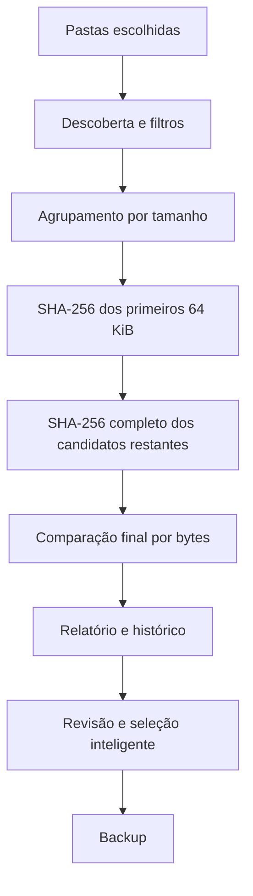

# Dedup — identificação e resolução controlada de arquivos duplicados

Aplicação desktop para analisar arquivos no Windows, identificar conteúdos duplicados e preparar sua resolução com rastreabilidade e possibilidade de recuperação.

O sistema está em desenvolvimento. A identificação de duplicatas, o histórico, a auditoria e partes do backup estão implementados. O fluxo completo de resolução ainda não está liberado.

**Última conferência do código: 23/11/2026.**

## 1. Contexto do projeto

O sistema será utilizado em um ambiente com documentos extremamente sensíveis. A perda de um arquivo pode causar prejuízos elevados.

O volume total informado supera 2 TB. A execução será dividida por pastas, com lotes geralmente entre 10 e 50 GB, preferencialmente nos fins de semana.

O operador deverá executar a rotina pela interface gráfica:

1. Escolher uma ou mais pastas.
2. Analisar seus arquivos e subpastas.
3. Consultar duplicatas, exclusões e ocorrências.
4. Revisar a seleção dos arquivos.
5. Criar e verificar backups.
6. Executar a resolução quando o executor seguro estiver implementado.
7. Recuperar arquivos quando necessário.

Não haverá cadastro obrigatório de setores. A pasta escolhida define o escopo da análise e inclui suas subpastas.

O funcionamento depende da quantidade de arquivos, das permissões, da rede e do armazenamento. O tamanho em GB, isoladamente, não determina o consumo de memória ou o tempo de execução.

## 2. Decisões de escopo

| Item | Decisão |
|---|---|
| Sistema operacional | Windows |
| Compartilhamentos de rede | Devem ser homologados no ambiente real |
| Operação | Manual, pela interface |
| Agendamento | Fora do escopo atual |
| Cadastro de setores e perfis | Retirado do fluxo do operador |
| Criação de hardlinks | Retirada do escopo |
| Substituição por arquivos `.lnk` | Retirada do escopo |
| Identificação automática de SMB/NTFS e outros ambientes | Adiada |
| Resolução de duplicatas | Depende do módulo 7 |
| Conclusão do módulo 5 | Ficará por último, conforme decisão do projeto |

Adiar a identificação automática do armazenamento não elimina a necessidade de verificar capacidades, permissões e recuperação no servidor real.

A aplicação deve recusar uma operação quando não conseguir atender às verificações exigidas pelo fluxo.

## 3. Situação atual dos módulos

É necessário distinguir código aplicado de código proposto no chat.

| Módulo | Objetivo | Situação verificada |
|---|---|---|
| 1 | Filtros e descoberta | Aplicado, com testes locais |
| 2 | Pipeline de comparação | Aplicado, com testes locais |
| 3 | Auditoria e persistência | Aplicado, com testes locais |
| 4 | Seleção inteligente | Aplicado, com testes locais |
| 5 | Rotina manual pela interface | Parcialmente aplicado; integração pendente |
| 6.1 | Catálogo e restauração de conteúdo | Arquivos aplicados; chamada de integração na janela ainda incorreta |
| 6.2 | Captura nativa Windows | Aplicada; restauração completa ainda não está no código atual |
| Conclusão do módulo 6 | Restauração Windows, prova de recuperação, reconciliação e interface | Proposta completa enviada no chat, ainda não aplicada |
| 7 | Resolução segura e quarentena | Pendente |

**O projeto ainda não está aprovado para produção.**

## 4. Como a análise funciona



### 4.1. Descoberta e exclusões

O Scanner percorre as pastas selecionadas e suas subpastas.

São considerados:

- Nomes de pastas ignoradas.
- Extensões ignoradas.
- Caminhos explicitamente excluídos.
- Expressões regulares.
- Arquivos e diretórios ocultos ou de sistema.
- Links, reparse points e situações incompatíveis com o escopo protegido.
- Identidade dos arquivos, para reconhecer caminhos que representam o mesmo arquivo físico.

Os filtros são aplicados antes das leituras de conteúdo. Algumas verificações precisam consultar metadados do sistema de arquivos.

As ocorrências são registradas no relatório. Uma falha de acesso não deve ser apresentada como uma análise bem-sucedida daquele arquivo.

### 4.2. Agrupamento por tamanho

Arquivos com tamanhos diferentes não podem ter conteúdos integralmente iguais.

O sistema concentra as comparações nos grupos de mesmo tamanho.

### 4.3. Hash parcial

O sistema calcula SHA-256 dos primeiros **64 KiB** dos candidatos.

Quando tamanho e prefixo não coincidem, o arquivo não precisa avançar para a leitura integral daquela comparação.

O hash parcial funciona como filtro. Ele não confirma duplicidade.

### 4.4. Hash completo e comparação por bytes

Somente os candidatos restantes avançam para:

1. SHA-256 completo.
2. Comparação final por bytes.

O sistema também observa identidade e versão do arquivo antes e depois das leituras.

Alterações, leituras incompletas e falhas invalidam a conclusão correspondente ou geram uma pendência.

### 4.5. Limite da conclusão

A análise registra uma igualdade observada em determinado momento e escopo.

Ela não é um snapshot atômico do servidor e não protege permanentemente os arquivos contra alterações posteriores.

Antes de qualquer resolução, o módulo 7 deverá revalidar o arquivo selecionado e a referência preservada.

A identificação atual das duplicatas compara o conteúdo principal dos arquivos. A política de resolução também deverá considerar diferenças de ADS, permissões e outros metadados.

## 5. O que já está implementado

### 5.1. Módulo 1 — filtros e inventário

- [x] Exclusão por nome de pasta.
- [x] Exclusão por extensão.
- [x] Exclusão por caminho.
- [x] Exclusão por expressões regulares.
- [x] Tratamento de ocultos e arquivos de sistema.
- [x] Tratamento de links e reparse points.
- [x] Validação da configuração.
- [x] Registro dos arquivos ignorados.
- [x] Registro de falhas e recuperações do inventário.
- [x] Tentativas controladas.
- [x] Testes com arquivos artificiais.

Os padrões incluem diretórios como `.git`, `node_modules`, `Windows`, `AppData` e `$RECYCLE.BIN`.

As extensões padrão incluem `.tmp`, `.sys`, `.ini`, `.dll`, `.log`, `.bak` e `.cab`.

Esses padrões precisam ser revisados conforme a finalidade da análise. Arquivos ignorados ficam fora da comparação.

### 5.2. Módulo 2 — comparação em camadas

- [x] Agrupamento por tamanho.
- [x] Hash parcial de 64 KiB.
- [x] Encaminhamento dos candidatos restantes ao hash completo.
- [x] Comparação final por bytes.
- [x] Verificação de identidade e versão.
- [x] Controle de tentativas.
- [x] Invalidação de conclusões afetadas por falhas.
- [x] Tratamento de candidatos recuperados.
- [x] Testes de colisão simulada e alteração de conteúdo.

Estados relevantes:

| Estado | Significado |
|---|---|
| `NO_PARTIAL_MATCH` | Sem par de mesmo tamanho e prefixo na análise |
| `MATCH_OBSERVED` | Igualdade observada; exige revalidação para agir |
| `NO_CONFIRMED_MATCH` | Sem duplicata confirmada entre os candidatos processados |
| `SAME_FILE` | Caminhos associados ao mesmo arquivo físico |
| `FAILED` | Processamento não concluído |

### 5.3. Módulo 3 — auditoria e histórico

- [x] Auditoria em JSONL.
- [x] Identificação de conta, máquina, processo e sessão.
- [x] Eventos de início, sucesso e falha.
- [x] Datas de auditoria em UTC.
- [x] Tratamento explícito de falhas de gravação.
- [x] Rotação dos logs.
- [x] Histórico em SQLite.
- [x] Verificação de integridade dos relatórios.
- [x] Proteção contra substituição indevida de relatórios não salvos.
- [x] Nova tentativa de gravação do relatório.
- [x] Distinção entre operação concluída e falha posterior de auditoria.

O relatório histórico representa uma observação passada. Ele não autoriza operações sobre os arquivos atuais.

Os checksums ajudam a detectar corrupção e inconsistência. Eles não substituem controle de acesso, proteção do armazenamento e cópias independentes dos registros.

### 5.4. Módulo 4 — seleção inteligente

- [x] Menu de estratégias de marcação.
- [x] Preservação por pasta oficial.
- [x] Estratégias por criação e modificação.
- [x] Preservação do arquivo mais antigo ou mais novo.
- [x] Bloqueio de grupos com empate ou informação insuficiente.
- [x] Validação do escopo e das evidências do relatório.
- [x] Proteção da referência automática contra marcação.
- [x] Auditoria da seleção.
- [x] Testes do planejador e da interface.

A seleção inteligente prepara uma revisão. Ela não autoriza exclusão.

### 5.5. Módulo 5 — componentes presentes

- [x] Motor de análise compartilhado.
- [x] Bloqueio de execução entre processos no mesmo Windows.
- [x] Registro persistente da execução.
- [x] Checkpoint do relatório completo.
- [x] Componentes de cancelamento cooperativo.
- [x] Componentes gráficos para recuperação de relatórios.
- [ ] Corrigir a integração desses componentes com a janela.
- [ ] Concluir e aprovar os testes da rotina gráfica.

O bloqueio atual não coordena computadores diferentes que acessem o mesmo compartilhamento.

A recuperação existente recupera um relatório completo previamente registrado. Ela não retoma uma varredura interrompida arquivo por arquivo.

## 6. Problemas conhecidos da interface atual

Estes problemas foram encontrados no código presente no projeto.

### 6.1. Início duplicado da análise

`DedupApp.iniciar_varredura()` chama `start_manual_analysis()` e continua executando o fluxo antigo com `ScanWorker`.

Isso pode criar duas tarefas e substituir a referência à tarefa nova, prejudicando acompanhamento, cancelamento e recuperação.

### 6.2. Atualização dos controles manuais

A chamada de `update_manual_controls()` ainda precisa ser integrada ao fluxo de atualização da janela.

Os botões podem apresentar estados incompatíveis com a execução.

### 6.3. Relatório preservado por checkpoint

A proteção de troca de relatório reconhece um checkpoint válido, mas alguns controles continuam bloqueados pela condição de relatório não salvo.

As condições precisam ser alinhadas.

### 6.4. Catálogo de backups não inicializado corretamente

No construtor de `DedupApp`, está presente:

```python
setup_backup_catalog
```

A integração precisa executar a função:

```python
setup_backup_catalog(self)
```

A entrega completa do módulo 6 também exige os demais ajustes enviados para a janela.

### 6.5. Configuração pela interface

A edição dos filtros ainda precisa ser disponibilizada ao operador pela interface.

Na proposta completa do módulo 6, a escolha do destino dos backups já foi incluída, mas essa proposta ainda não está aplicada.

## 7. Módulo 6 — estado do backup e da recuperação

### 7.1. Funcionalidades presentes no código atual

#### Backup do conteúdo principal

O `ActionManager` implementa:

- Cópia para uma operação identificada por UUID.
- Manifesto da operação.
- Conferência por SHA-256 e bytes.
- Marcador de conteúdo verificado.
- Restauração para arquivo novo.
- Recusa de sobrescrita.
- Preservação e indicação de arquivos parciais em falhas.
- Auditoria das operações.

Esse formato não preserva integralmente permissões, proprietário, ADS e metadados Windows.

Estrutura:

```text
<backup>/<UUID>/
├── operation.json
├── verified.json
└── content.bin
```

#### Catálogo

Os arquivos do catálogo e do diálogo existem, com testes próprios.

A chamada de inicialização na janela principal ainda está incorreta.

#### Captura Windows da etapa 6.2

`windows_backup.py` está presente.

Ele captura fluxos Windows com `BackupRead`, registra metadados básicos e confere a captura no perfil suportado.

Estrutura:

```text
<backup>/<UUID>/
├── operation.json
├── verified.json
└── windows.bin
```

O marcador registra:

```text
restore_validated = False
deletion_authorized = False
```

Isso representa uma captura conferida, sem comprovação de restauração completa.

### 7.2. Entrega completa enviada no chat

Foi enviada uma proposta que acrescenta:

- Contexto temporário de privilégios por thread.
- Pastas privadas criadas antes da gravação dos dados.
- Conferência das permissões efetivamente armazenadas.
- Restauração nativa com `BackupWrite`.
- Conferência dos dados e ADS por bytes.
- Conferência semântica da segurança.
- Restauração das datas e atributos do perfil.
- Prova de restauração vinculada ao hash do backup.
- Registros persistentes das restaurações.
- Reconciliação de operações interrompidas.
- Verificação de espaço e reserva de capacidade.
- Interface para captura, restauração, teste e reconciliação.
- Escolha do destino pela interface.
- Compatibilidade com restauração dos backups antigos.

**Essa entrega ainda não foi aplicada ao projeto conferido.**

Arquivos novos ainda ausentes:

```text
src/core/windows_native.py
src/core/windows_recovery.py
tests/test_module6_complete.py
```

Também estão pendentes:

- Ajustes em `src/core/windows_backup.py`.
- Substituição de `src/core/backup_catalog.py`.
- Substituição de `src/gui/backup_catalog.py`.
- Integração em `src/gui/app.py`.

### 7.3. Prova de restauração proposta

A captura original permanece registrada em `verified.json`.

Uma restauração testada gera um registro separado:

```text
<backup>/<UUID>/
├── operation.json
├── verified.json
├── windows.bin
├── restore-proof-<UUID>.json
└── restores/
    └── <UUID>.json
```

A prova fica ligada ao hash do arquivo de backup.

O catálogo proposto distingue:

| Estado | Significado |
|---|---|
| `CONTENT_VERIFIED` | Backup antigo de conteúdo principal |
| `WINDOWS_CAPTURED` | Captura Windows íntegra, sem prova aceita de restauração |
| `WINDOWS_VERIFIED` | Backup com prova de restauração |
| `INCOMPLETE` | Captura sem confirmação final |
| `UNAVAILABLE` | Registro inválido, incompatível ou inacessível |

Mesmo com uma prova válida, o backup não recebe autorização automática para remover o original.

### 7.4. Reconciliação proposta

Os registros permitem distinguir situações como:

- Restauração concluída.
- Restauração interrompida.
- Arquivo parcial ou inacessível.
- Destino não encontrado.
- Arquivo do destino substituído.
- Teste temporário interrompido.
- Necessidade de revisão manual.

A reconciliação não deve sobrescrever um arquivo existente nem presumir que ele pertence à operação.

### 7.5. Perfil e limites

A proposta trata arquivos regulares dentro do perfil validado.

Recursos ainda não suportados são recusados, incluindo situações como:

- EFS.
- Arquivos compactados ou esparsos.
- Reparse points.
- Múltiplos vínculos físicos.
- Fluxos especiais fora do perfil implementado.

O horário interno `ChangeTime` original permanece registrado no backup. No arquivo recuperado, ele representa a nova operação de recuperação.

A restauração de um arquivo não recria as permissões de toda a árvore de pastas de origem. O destino precisa ser escolhido com cuidado.

A proposta exige os direitos:

```text
SeBackupPrivilege
SeRestorePrivilege
SeSecurityPrivilege
```

O código não concede esses direitos à conta. Ele utiliza direitos já atribuídos e encerra o contexto temporário ao terminar.

## 8. Módulo 7 — pendente

O executor de resolução ainda precisa ser implementado.

Checklist:

- [ ] Gerar um plano de operações para revisão.
- [ ] Identificar claramente o arquivo preservado em cada grupo.
- [ ] Vincular a operação às evidências revisadas.
- [ ] Revalidar o arquivo selecionado imediatamente antes da ação.
- [ ] Revalidar e proteger a referência preservada.
- [ ] Definir a política para diferenças de ADS, ACLs e metadados.
- [ ] Exigir os requisitos de backup e recuperação aplicáveis.
- [ ] Implementar quarentena recuperável.
- [ ] Registrar cada mudança de estado.
- [ ] Reconciliar operações interrompidas.
- [ ] Evitar repetição indevida de operações já concluídas.
- [ ] Restaurar sem sobrescrever arquivos existentes.
- [ ] Definir retenção da quarentena.
- [ ] Separar descarte definitivo da rotina inicial.
- [ ] Implementar os controles pela interface.
- [ ] Executar os testes de falha e recuperação.

Os métodos legados de remoção e substituição continuam bloqueados.

A existência desses métodos no código não representa uma funcionalidade liberada.

## 9. Arquitetura do código atual

```text
dedup/
├── README.md
├── requirements.txt
├── config/
│   └── settings.json
├── src/
│   ├── main.py
│   ├── cli.py
│   ├── core/
│   │   ├── action_manager.py
│   │   ├── analysis.py
│   │   ├── backup_catalog.py
│   │   ├── cancellation.py
│   │   ├── exclusion_patterns.py
│   │   ├── hasher.py
│   │   ├── report_store.py
│   │   ├── run_journal.py
│   │   ├── run_lock.py
│   │   ├── scanner.py
│   │   ├── smart_mark.py
│   │   └── windows_backup.py
│   ├── gui/
│   │   ├── app.py
│   │   ├── backup_catalog.py
│   │   ├── components.py
│   │   └── manual.py
│   └── utils/
│       ├── audit.py
│       ├── config_parser.py
│       └── logger.py
├── tests/
│   ├── test_backup_catalog.py
│   ├── test_graphical_manual.py
│   ├── test_hasher_partial.py
│   ├── test_module3.py
│   ├── test_module4.py
│   ├── test_scanner_filters.py
│   └── test_windows_backup.py
├── data/
│   ├── relatorios.sqlite
│   └── execucoes/
└── logs/
```

Arquivos `__init__.py` e artefatos de execução foram omitidos da representação.

### Responsabilidades

| Arquivo | Responsabilidade |
|---|---|
| `main.py` | Inicialização da aplicação, auditoria e erros de abertura |
| `scanner.py` | Descoberta, filtros, inventário e recuperação de falhas |
| `hasher.py` | Hash parcial, hash completo e comparação por bytes |
| `analysis.py` | Orquestração da análise |
| `smart_mark.py` | Planejamento da seleção inteligente |
| `report_store.py` | Persistência e consulta dos relatórios |
| `action_manager.py` | Backup e restauração do conteúdo principal |
| `windows_backup.py` | Captura nativa Windows da etapa 6.2 |
| `backup_catalog.py` | Catálogo dos backups |
| `run_lock.py` | Exclusão mútua no mesmo Windows |
| `run_journal.py` | Estado persistente e checkpoint |
| `cancellation.py` | Cancelamento cooperativo |
| `gui/app.py` | Janela principal |
| `gui/manual.py` | Controles da execução manual e recuperação de relatórios |
| `gui/backup_catalog.py` | Consulta e restauração de backups pela interface |
| `config_parser.py` | Validação e gravação da configuração |
| `logger.py` | Auditoria JSONL |
| `audit.py` | Associação entre início, resultado e falhas de auditoria |

`cli.py` permanece como implementação legada de apoio técnico. O fluxo definido para o operador é gráfico, sem cadastro de perfis por setor.

## 10. Configuração

Arquivo:

```text
config/settings.json
```

Exemplo exclusivamente para laboratório:

```json
{
  "monitored_paths": [
    "C:/DedupLab/Entrada"
  ],
  "backup_path": "C:/DedupLab/Backup",
  "min_file_size_bytes": 1,
  "chunk_size_bytes": 65536,
  "excluded_paths": [
    "C:/DedupLab/Entrada/NaoComparar"
  ],
  "ignored_dirs": null,
  "ignored_exts": null,
  "ignored_path_patterns": []
}
```

O exemplo não representa uma validação de independência física do armazenamento.

### Campos

| Campo | Finalidade |
|---|---|
| `monitored_paths` | Pastas que participarão da análise |
| `backup_path` | Área destinada aos backups |
| `min_file_size_bytes` | Tamanho mínimo considerado |
| `chunk_size_bytes` | Bloco de leitura utilizado |
| `excluded_paths` | Caminhos excluídos |
| `ignored_dirs` | Nomes de pastas ignoradas |
| `ignored_exts` | Extensões ignoradas |
| `ignored_path_patterns` | Expressões regulares de exclusão |

Nos filtros de nomes e extensões:

- `null` utiliza os padrões do Scanner.
- `[]` desativa o filtro correspondente.

A área de backup entra nos caminhos excluídos da análise.

As gravações de configuração são validadas e utilizam arquivo temporário antes da substituição do JSON.

### Limites relevantes

| Parâmetro | Valor |
|---|---:|
| Prefixo do hash parcial | 64 KiB |
| Máximo de expressões regulares | 32 |
| Tamanho máximo de cada expressão | 512 caracteres |
| Timeout de correspondência | 0,02 s por regra |
| Limite de tentativas do hasher | 2 |
| Limite do arquivo de estado | 256 MiB |
| Limite de captura Windows por arquivo | 1 TiB |
| Limite de fluxos da captura Windows | 1.024 |

O timeout da regex é um limite por tentativa de correspondência. Ele não representa o tempo total de filtragem de uma pasta.

O volume em bytes não substitui o controle da quantidade de registros. Muitos arquivos pequenos podem gerar relatórios grandes e atingir limites de memória ou de checkpoint.

## 11. Persistência e recuperação

### Relatórios

O SQLite armazena snapshots das análises, suas configurações e os respectivos períodos de execução.

A consulta histórica não deve consultar novamente os arquivos para alterar o significado do relatório passado.

### Estado da execução

O diretório `data/execucoes` recebe os registros das execuções manuais.

Um registro de fase não significa que exista um relatório completo recuperável.

A recuperação depende de um snapshot completo e consistente.

### Auditoria

Os logs JSONL registram contexto e resultado das operações.

Uma falha de auditoria pode ocorrer:

1. Antes da operação: a operação não deve começar.
2. Depois da operação: o resultado realizado precisa ser distinguido da falha de registro.

Essa distinção é necessária para evitar repetir uma operação concluída.

### Artefatos sensíveis

Relatórios, logs e manifestos podem conter caminhos, nomes de arquivos e informações operacionais sensíveis.

Eles precisam de controle de acesso e política própria de proteção e retenção.

## 12. Ambiente e dependências

O ambiente utilizado nos testes locais é Windows com Python 3.15.

Dependências declaradas:

```text
PyQt6>=6.6.0
regex==2026.9.29
```

Outros componentes utilizam a biblioteca padrão, incluindo SQLite, hashing, JSON e APIs Windows por `ctypes`.

A compatibilidade com outras versões do Python e do Windows precisa ser homologada.

### Preparação pela equipe técnica

Exemplo de criação de ambiente virtual:

```powershell
& "$env:LOCALAPPDATA\Programs\Python\Python315\python.exe" -m venv .venv

& ".\.venv\Scripts\python.exe" -m pip install -r requirements.txt
```

Inicialização gráfica para homologação:

```powershell
& ".\.venv\Scripts\pythonw.exe" .\src\main.py
```

Esses comandos são destinados à preparação técnica. O operador deve receber uma forma de abertura da interface sem depender de terminal.

No estado atual, a execução manual deve utilizar dados artificiais de laboratório até a conclusão dos bloqueios conhecidos.

## 13. Testes e evidências

### 13.1. Código atualmente aplicado

Na conferência de 23/11/2026:

```text
Ran 209 tests

OK (skipped=1)
```

Resultado:

- 208 testes aprovados.
- 1 teste pulado por falta de acesso à SACL.
- Nenhuma falha nessa composição.
- Testes do módulo 5 gráfico excluídos.

Comando utilizado:

```powershell
$env:QT_QPA_PLATFORM = "offscreen"

& "$env:LOCALAPPDATA\Programs\Python\Python315\python.exe" -B -m unittest discover -s tests -p "test_[!g]*.py"
```

O padrão exclui `test_graphical_manual.py`. Esse resultado não representa aprovação da suíte completa.

### 13.2. Proposta completa do módulo 6

A entrega completa enviada no chat foi testada em memória com dados artificiais:

```text
Ran 242 tests

OK (skipped=2)
```

Resultado da proposta:

- 240 testes aprovados.
- 2 testes pulados relacionados à validação integral da SACL.
- Nenhuma falha.
- Testes do módulo 5 gráfico excluídos.

Essa execução não comprova que a proposta foi aplicada ao diretório do projeto.

O novo arquivo proposto contém 33 testes:

```text
tests/test_module6_complete.py
```

Ele ainda não está presente no código conferido.

### 13.3. Depois de aplicar a conclusão do módulo 6

Antes de executar os testes novos, confirme que o arquivo foi adicionado:

```powershell
if (-not (Test-Path -LiteralPath ".\tests\test_module6_complete.py")) {
    throw "A entrega completa do módulo 6 ainda não foi aplicada."
}
```

Execute:

```powershell
$env:QT_QPA_PLATFORM = "offscreen"

& "$env:LOCALAPPDATA\Programs\Python\Python315\python.exe" -B -m unittest discover -s tests -p "test_module6_complete.py" -v
```

Depois, execute a composição sem o módulo 5 gráfico:

```powershell
& "$env:LOCALAPPDATA\Programs\Python\Python315\python.exe" -B -m unittest discover -s tests -p "test_[!g]*.py"
```

Após corrigir o módulo 5, será necessário executar e aprovar a suíte completa:

```powershell
& "$env:LOCALAPPDATA\Programs\Python\Python315\python.exe" -B -m unittest discover -s tests -p "test_*.py"
```

### 13.4. Cenários de validação

| Categoria | Exemplos |
|---|---|
| Funcionamento básico | Pastas vazias, arquivos pequenos, subpastas e duplicatas |
| Escopo | Caminhos sobrepostos, exclusões, nomes semelhantes e pastas oficiais |
| Comparação | Prefixos diferentes, caudas diferentes e colisões simuladas |
| Identidade | Arquivo substituído, alterado ou associado a outro caminho |
| Acesso | Permissão negada, arquivo bloqueado e diretório indisponível |
| Persistência | Falha no SQLite, checkpoint corrompido e identificador conflitante |
| Auditoria | Falha inicial, falha final, gravação parcial e rotação |
| Backup | Conteúdo corrompido, manifesto inválido e captura incompleta |
| Restauração | Destino existente, arquivo parcial e dados divergentes |
| Windows | ADS, ACLs, SACL, datas e arquivo somente leitura |
| Interrupção | Falha antes, durante e depois da gravação |
| Recursos | Espaço insuficiente, muitos arquivos e relatórios grandes |
| Interface | Controles, fechamento durante operação, recuperação e histórico |

Testes artificiais não substituem a homologação no servidor real.

## 14. Pendências antes de produção

### Aplicação do módulo 6

- [ ] Aplicar os ajustes na captura, catálogo e janela.
- [ ] Executar a composição conjunta.
- [ ] Validar os testes de SACL com a conta autorizada, sem pulá-los.
- [ ] Conferir permissões da área de backup.
- [ ] Validar restauração em destino com permissões diferentes.
- [ ] Confirmar capacidade e independência do armazenamento.

### Módulo 7

- [ ] Implementar o plano revisável.
- [ ] Implementar a revalidação dos arquivos e da referência.
- [ ] Implementar quarentena e recuperação.
- [ ] Definir retenção e descarte definitivo.
- [ ] Aprovar os testes de falha e reinício.

### Módulo 5

- [ ] Remover a continuação indevida do fluxo antigo de análise.
- [ ] Integrar a atualização dos controles manuais.
- [ ] Alinhar os controles com a proteção por checkpoint.
- [ ] Concluir a configuração necessária pela interface.
- [ ] Revisar as referências legadas a perfis e setores.
- [ ] Aprovar os testes gráficos de ponta a ponta.

### Homologação operacional

- [ ] Testar caminhos UNC e unidades mapeadas.
- [ ] Testar permissões reais do servidor.
- [ ] Testar arquivos abertos e bloqueados.
- [ ] Simular desconexões de rede.
- [ ] Simular falta de espaço e falhas de gravação.
- [ ] Validar nomes Unicode e caminhos longos.
- [ ] Medir tempo, memória, serialização e I/O.
- [ ] Testar lotes representativos de 10 a 50 GB.
- [ ] Testar grande quantidade de arquivos pequenos.
- [ ] Definir a coordenação se houver execução em mais de um computador.
- [ ] Executar um exercício completo de recuperação.
- [ ] Executar piloto controlado antes da operação definitiva.

### Entrega e manutenção

- [ ] Preparar abertura da aplicação sem terminal.
- [ ] Fixar e homologar as versões utilizadas na distribuição.
- [ ] Documentar a conta de execução e suas permissões.
- [ ] Definir política de logs, relatórios, backups e retenção.
- [ ] Revisar o `.gitignore`.
- [ ] Versionar os testes.
- [ ] Retirar artefatos operacionais do versionamento por procedimento revisado, preservando suas cópias.

Na conferência atual, o banco `data/relatorios.sqlite` e o log legado `logs/auditoria_dedup.log` constam no Git. Os arquivos de testes encontrados não constam na listagem de arquivos rastreados consultada.

Não apagar evidências operacionais como parte de uma limpeza de repositório.

## 15. Ordem de continuidade acordada

1. Aplicar e validar a conclusão do módulo 6.
2. Implementar e testar o módulo 7.
3. Finalizar o módulo 5.
4. Executar a suíte completa.
5. Homologar no servidor real.
6. Executar piloto controlado.
7. Autorizar a entrada em produção após o aceite.

## 16. Contexto para continuidade por outro desenvolvedor

Antes de modificar o projeto:

- Conferir o código real e os testes presentes.
- Distinguir implementação aplicada de proposta enviada no chat.
- Preservar a divisão por módulos.
- Apresentar alterações com localização e justificativa.
- Respeitar a preferência atual por receber os códigos no chat, sem edição direta dos arquivos.
- Utilizar dados artificiais nos testes de desenvolvimento.
- Manter o fluxo do operador na interface.
- Manter hardlinks, atalhos `.lnk` e cadastro obrigatório de setores fora do escopo.
- Manter a remoção bloqueada enquanto o executor seguro não estiver implementado e validado.
- Não tratar um teste pulado como aprovação.
- Não tratar um relatório histórico como autorização sobre o estado atual dos arquivos.
- Não declarar segurança absoluta ou aprovação de produção com base apenas nos testes locais.

O ponto de retomada atual é a aplicação da entrega completa do módulo 6. Os módulos 7 e 5 permanecem pendentes, nessa ordem.
